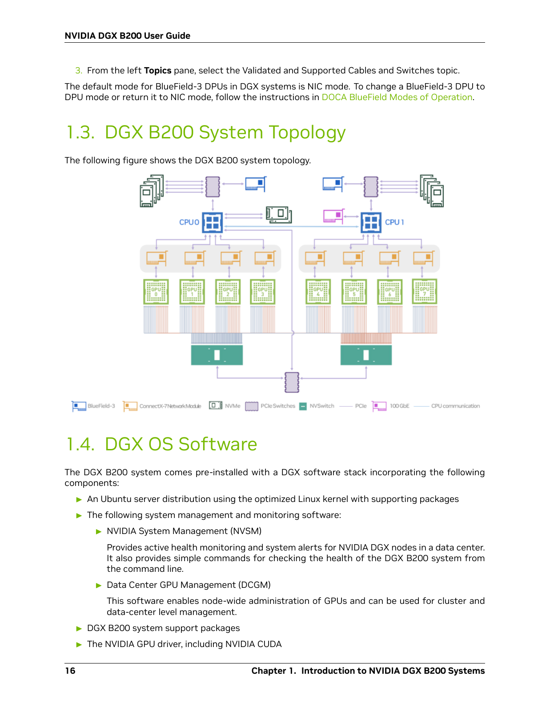

# Create Your First Retrieval Bundle

Generate retrieval queries from a page of NVIDIA hardware documentation, inspect
their supporting evidence, and identify which training views preserve that evidence.
You need basic command-line and YAML knowledge. No document extraction is needed.

The example uses printed page 16 (PDF page 22) of the
[NVIDIA DGX B200 User Guide](https://docs.nvidia.com/dgx/dgxb200-user-guide/dgxb200-user-guide.pdf#page=22),
dated September 8, 2026. It checks generation and inspection using real source
material. One page is not enough to assess training or retrieval quality.

## 1. Install and Configure Models

Use a repository checkout containing the multimodal workflow, Python 3.10 or
later, an active Python environment, and `uv`. From the repository root, run:

```bash
uv pip install ./plugins/data-designer-retrieval-sdg
python -m data_designer_retrieval_sdg.multimodal --help
cp plugins/data-designer-retrieval-sdg/docs/assets/first-run/sdg.yaml ./sdg.yaml
```

Edit `sdg.yaml` before running it:

- Replace both model placeholders and endpoint URLs with your deployment values.
  The generator and judge must both accept images and structured responses.
- Adjust sampling, output-token limits, timeouts, and provider-specific options
  for your models. Refer to [Model Settings](multimodal-reference.md#model-settings).
  For reasoning models, allow enough output tokens for reasoning and the structured response.
- Set the environment variable named `SDG_API_KEY` through your credential-management
  process. The YAML contains the variable name, not the credential.
- Keep `output_dir` pointed at a new directory. An existing completed or interrupted
  run requires the [resume procedure](multimodal.md#resume-an-interrupted-run).

The [downloadable configuration](assets/first-run/sdg.yaml) includes explicit text
and topology-diagram instructions, one source per context, and one concurrent request.
These choices make the first run easier to inspect. They do not impose an
aggregate request, token, or spending limit. Monitor usage through your provider.

## 2. Inspect the Supplied Page

The [source file](assets/first-run/sources.jsonl) uses JSON Lines (JSONL): one JSON
object per retrievable source unit. This example has one unit,
`dgx-b200-page-16`, containing extracted text and a rendered page image:

| Content | What It Provides |
| --- | --- |
| Extracted text | The purposes of NVIDIA System Management (NVSM) and Data Center GPU Management (DCGM), plus other DGX OS software components. |
| Page image | The system topology, including CPU/GPU groupings and connections, and the software text below it. |

Image paths resolve relative to `sources.jsonl`. Configuration paths resolve from
where you run the command. Keep running from the repository root with the supplied
configuration. If you download the files separately, keep
[dgx-b200-page-16.png](assets/first-run/dgx-b200-page-16.png) beside
`sources.jsonl` and update `sources_file` in your configuration.

The supplied image is a direct render of the PDF page. The text preserves the
extracted wording from sections 1.3 and 1.4, with line wrapping normalized and
running headers and footers removed. The image also retains the end of the
preceding networking section at the top of the page. The
[source provenance](assets/first-run/provenance.json) records the
original URL, document date, page numbers, preparation steps, and file checksums.
PDF extraction and rendering are already complete for this example; the plugin
consumes the prepared JSONL and image.

The topology diagram contains visual relationships that are absent from the
extracted text. The image also includes the software prose, so some facts are
available through both representations:



The run requests two tasks for this page: a software-purpose question and a
question about a visible topology relationship. A task can abstain when it cannot
find suitable evidence. Summary and query checks can also reject candidates.
Two requested slots do not imply two accepted queries.

## 3. Generate and Inspect Results

Run the configuration:

```bash
python -m data_designer_retrieval_sdg.multimodal --config ./sdg.yaml
```

A completed run prints the path to
`runs/first-retrieval-bundle/bundle/generation_result.json`. If no queries pass,
the run fails without a completed handoff. Preserve its output and follow
[Troubleshoot a Small Run](multimodal.md#troubleshoot-a-small-run).

Save the following as `review_bundle.py` in the repository root to inspect counts
and view eligibility:

```python
import json
from pathlib import Path

bundle = Path("runs/first-retrieval-bundle/bundle")
report = json.loads((bundle / "report.json").read_text())
print("Requested:", report["requested_slots"])
print("Abstained:", report["abstentions"])
print("Generated:", report["candidate_records"])
print("Accepted:", report["accepted_query_ids"])
print("Rejections:", report["rejection_reasons"])
print("Views:", report["views"])
```

Run the inspection script from the repository root:

```bash
python review_bundle.py
```

Open `candidate_diagnostics.jsonl` in the same bundle directory and compare the
queries and supporting evidence with the supplied sources. Counts, wording, and
split assignments depend on model responses. The captured example below shows how
to interpret a result, not an output your model must reproduce.

## 4. Follow a Query From Source to View

This historical capture used an earlier exporter with three views. Its source
assets and recorded results are preserved; current runs also export a `mixed`
view. Inspect your own report for the current counts rather than expecting this
capture to reproduce exactly.

The captured run generated two questions and accepted both. The following is an
excerpt of the software question's actual diagnostic record:

```json
{
  "query": "What is the purpose of the NVIDIA System Management (NVSM) software in the DGX B200 system?",
  "evidence_modality": "text",
  "accepted": true,
  "localization": {
    "supports": [
      {
        "unit_id": "dgx-b200-page-16",
        "modality": "text",
        "quote": "Provides active health monitoring and system alerts for NVIDIA DGX nodes in a data center. It also provides simple commands for checking the health of the DGX B200 system from the command line."
      }
    ]
  },
  "quote_verification": {
    "dgx-b200-page-16": true
  }
}
```

Find the quotation in the supplied text. It directly supports the question, and
`quote_verification` confirms that the quoted wording occurs in the source.
That check does not independently verify the judge's interpretation.

The other accepted question was:

> How are the GPUs connected to the CPUs in the DGX B200 system topology?

Its generated `evidence_modality` was `image`, but the localization judge recorded
`text_and_image` support: the topology diagram plus its section heading and introductory sentence.
These fields describe different stages. Export eligibility follows the localized
support, so the image-only view excluded this question:

| View | Accepted Queries | Training | Evaluation |
| --- | ---: | ---: | ---: |
| `text` | 1 | 1 | 0 |
| `image` | 0 | 0 | 0 |
| `image_and_text` | 2 | 1 | 1 |

In the captured export, the software question appears in `text` and
`image_and_text`. Although its prose is also visible in the page image, the recorded support is `text`. The exporter
does not infer an alternative image support label. Likewise, the topology
question appears only in the captured `image_and_text` view. With the current
export rules applied to those recorded supports, `mixed` would preserve both
questions and their complete positive sets. This is a view-eligibility
explanation, not a new model run. Review whether both
modalities are actually necessary; a model's support label is not a human-verified ground-truth label.

A view's accepted count includes all its splits. In this capture, the text view
contains one training question and no evaluation questions. The combined view
contains one of each. Inspect the split counts before selecting a view for
training or evaluation. With only one source page, the split does not establish
generalization to unseen documents.

Review the visual explanation in `candidate_diagnostics.jsonl` against the
original diagram. In this capture, it incorrectly places the purple PCIe switches
between the CPUs and orange network modules. The diagram draws CPU connections
directly to those modules. Preserve the record for review; do not treat the
accepted explanation as verified hardware guidance.

Acceptance and quote matching do not verify diagram interpretation. This example
demonstrates the generation, review, and export workflow; it does not establish
retrieval quality or readiness of the generated questions for training.

## Next Steps

Use [Generate Retrieval Data From Text and Images](multimodal.md) to substitute
your own corpus, choose instructions, and resume interrupted work. Refer to
[Evidence and Export Views](multimodal-concepts.md#evidence-and-export-views)
before selecting a representation, then follow
[Continue to Mining and Training](multimodal.md#continue-to-mining-and-training)
for the recipe handoff.
